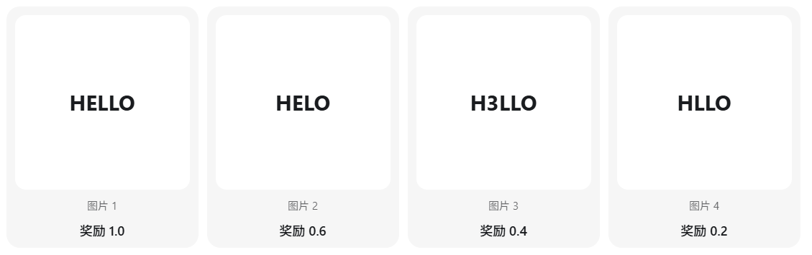
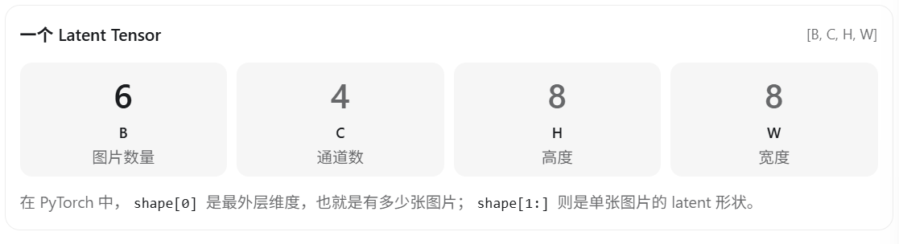
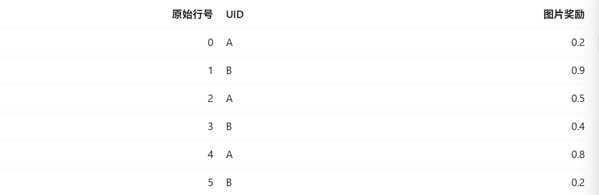
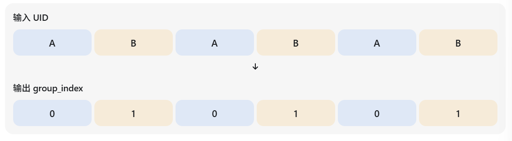
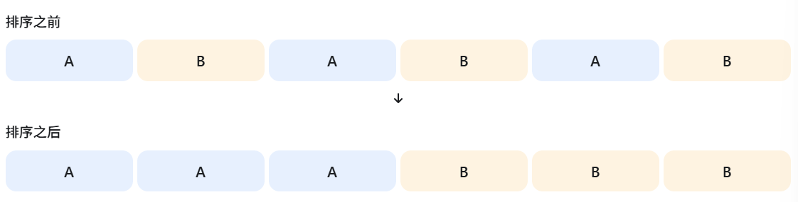
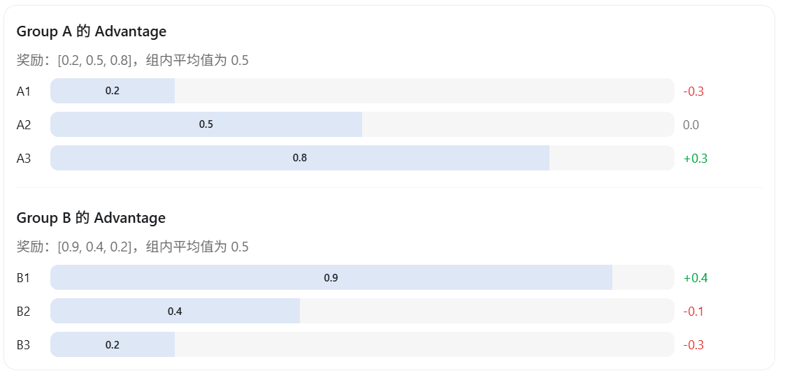
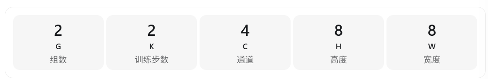
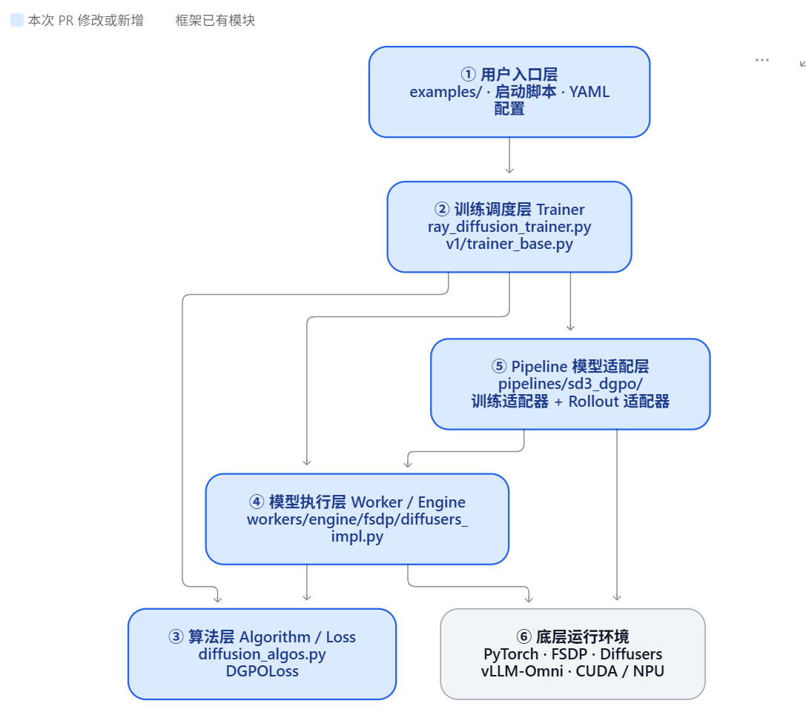

# 如何为 verl-omni 增加 DGPO 算法

## 1.简介

最近对omni模型的强化学习比较感兴趣，但是之前接触不多，作为初学者在找资料的时候看到一个很有用的PR[[diffusion, trainer, model, tests, doc\] feat: add DGPO direct group preference optimization by MrlixiangWE · Pull Request #733 · verl-project/verl-omni](https://github.com/verl-project/verl-omni/pull/733/)

这个 PR 很适合用来学习 扩散模型（Diffusion Model）如何进行强化学习（RL）训练，因为它涉及算法、Loss 函数、数据处理、训练框架和模型推理。

**DGPO的目的是什么？**——让图像生成模型能够根据同一提示词下多张图片的奖励差异，学习生成更好的图片。

这个 PR主要新增了以下能力：

- DGPO 的 Loss 计算。
- 按组管理生成图片、奖励和训练数据。
- SD3.5 扩散模型的训练及采样适配器。
- LoRA 模型训练支持。
- 配套的 OCR 训练示例、配置与测试。

## 2.通过一个例子理解 DGPO

假设我们正在训练一个 AI 绘画模型，用户输入：

> 生成一张图片，图片里面写着「HELLO」。

模型针对同一个 Prompt 生成 4 张图片：



我们希望模型以后更容易正确生成 `HELLO`，减少拼写错误。

DGPO 的基本思路是：

1. 对同一个 Prompt 生成一组图片（Group）。
2. 用奖励模型（Reward Model）给它们评分。
3. 比较组内奖励，计算每张图片的 Advantage（优势）。
4. 比较当前模型与参考模型在这些样本上的预测误差，形成组级偏好权重。
5. 利用加权的训练损失更新模型，使生成结果向更高奖励的方向改进。

这就是DGPO(Direct Group Preference Optimization)，后面我们深入PR看看这个训练框架是怎么接入这个算法的。

## 3.开源框架之间的联系

| 项目      | 定位                 | 用途                                              |
| --------- | -------------------- | ------------------------------------------------- |
| verl      | RL 后训练框架        | 主要面向语言模型的强化学习                        |
| VeRL-Omni | 多模态 RL 后训练框架 | 图片、视频、音频及 Omni 模型的强化学习            |
| vLLM-Omni | 多模态推理框架       | 高效执行多模态生成，也可以充当 RL 的 Rollout 引擎 |

在一个典型的多模态 RL 系统中，VeRL-Omni 可以使用 vLLM-Omni 执行生成，再利用奖励模型评分，最后通过训练后端更新模型参数。

那目前支持什么模型与算法呢？

| 模型       | 主要任务                 | 相关训练算法                |
| :--------- | :----------------------- | :-------------------------- |
| Qwen-Image | 图像生成                 | FlowGRPO、DiffusionNFT、DPO |
| Wan2.2     | 视频生成                 | Diffusion RL                |
| Qwen3-Omni | 文本、音频、视频等多模态 | GSPO、DPO                   |
| MiniMax-H3 | 视频与音频生成           | FlowGRPO、DiffusionNFT      |
| LTX2.3     | 视频和音频联合生成       | FlowGRPO                    |

其中比较重要的技术包括：

- FlowGRPO：面向 Flow Matching 生成模型的强化学习算法。
- GSPO：用于策略优化，适用于部分 Omni 模型训练。
- 异步奖励计算：让奖励模型评分与其他训练工作尽可能重叠。
- FSDP2 / VeOmni：支持分布式训练和不同并行策略。
- vLLM-Omni Rollout：加速训练过程中的模型生成。

## 4.深入PR

这个 PR 修改了 27 个文件。第一遍先关注下面 6 个就足够了。

| 阅读顺序 | 文件                           | 学习目标              |
| :------- | :----------------------------- | :-------------------- |
| ①        | docs/algo/dgpo.md              | 理解算法              |
| ②        | diffusion_algos.py             | 理解 Loss、组数据处理 |
| ③        | diffusers_impl.py              | 理解模型 Forward      |
| ④        | vllm_omni_rollout_adapter.py   | 理解图片生成          |
| ⑤        | run_sd35_medium_ocr_lora_v1.sh | 理解配置              |
| ⑥        | test_dgpo_on_cpu.py            | 理解如何测试算法      |

### 4.1 DGPO 的核心数学公式

源码位置：`diffusion_algos.py` 中的 `DGPOLoss` 类。

先看最基本的训练目标。

扩散模型的前向加噪过程可以写成：
$$
x_t=(1-t)x_0+t\epsilon
$$
这里：

- \(x_0\)：生成图片的干净 latent（潜在表示）
- \(\epsilon\)：随机噪声
- \(t\)：加噪程度，取值从 0 到 1
- \(x_t\)：加入噪声后的 latent

模型负责预测从干净样本向噪声变化的方向。

目标速度是：
$$
 v_{\text{target}}=\epsilon-x_0 
$$
我们希望模型预测的 \(v_\theta\) 接近目标速度，因此得到每个样本的误差：
$$
 d_i=\operatorname{mean}(v_{\text{target}}-v_\theta)^2 
$$
这就是 DGPO 使用的 Flow Matching 误差，代码里叫 `dsm`。

但 DGPO 不只是最小化这个误差。它还引入了组内的 Advantage 和组级权重：
$$
 s_G=\frac{\beta}{|G|}\sum_{i\in G}A_i(d_i-d_i^{ref}) 
$$
（根据组内相对好坏，调整每个样本的误差权重）

### 4.2DGPO代码实现

根据代码学习：

```python

target = ((xt.float() - x0.float()) / t_expanded.float()).detach() #计算训练目标 target
dsm = ((target - forward_prediction.float()) ** 2).mean(
    dim=reduce_dims
) #计算当前模型的误差 dsm
with torch.no_grad():
    ref_dsm = (
        (target - ref_forward_prediction.detach().float()) ** 2
    ).mean(dim=reduce_dims) #计算参考模型的误差 ref_dsm
```

`detach()` 和 `torch.no_grad()` 都用于阻止相应计算参与梯度传播。

然后是 DGPO 最关键的组权重计算：

```python
per_sample = ( #每张图片对组偏好分数的贡献
    advantages
    * loss_cfg.dgpo_beta
    * (dsm.detach() - ref_dsm)
    / group_size.float()
)
group_sums = torch.zeros(
    groups.numel(),
    device=x0.device,
    dtype=torch.float32,
)
group_sums.index_add_(0, inverse, per_sample)#把属于同一 Group 的贡献加起来
group_weights = torch.sigmoid(group_sums)
weights = group_weights[inverse]#把每个组的权重分配回组内各个样本
```

（**不关心绝对奖励，只关心同一 prompt 内部谁比谁好。**）

**注意：必须保留完整 Group！**

```py
requires_whole_groups = True
```

由于 DGPO 要求先对整组图片求和，才能得到 `group_weights`，如果同一组被拆开，组级分数就会不完整。

因此 PR 加入了三种保护措施：数据准备时把组排列成连续的顺序、Trainer 避免打乱组、Loss 验证组是否完整。不满足条件就报错。

## 5.精读：DGPOLoss.prepare_actor_batch()

为 Actor（需要训练的模型）准备一个 Batch（批次）。

后面所有代码，都以这个教学场景为例：

- 有 2 个 Prompt。
- 每个 Prompt 生成 3 张图片。
- 总共生成 6 张图片。
- 每张图片的 latent Shape 假设是 `[4, 8, 8]`。
- 每张图片的 Rollout 记录了 4 个时间步，训练时选择其中 2 个。

在扩散模型里，通常不会直接在像素空间（比如 512×512×3）上做扩散，而是先用 **VAE 编码器**把图片压缩到一个更小的**潜空间（latent space）**，再在潜空间里做加噪/去噪。

```
latents_clean.shape == (6, 4, 8, 8)
```



```python
def prepare_actor_batch(
        batch: DataProto,
        reward_tensor: torch.Tensor,#这 6 张图片各自的奖励
        config: Any,#算法配置
    ) -> DataProto:
    #检查数据，DGPO 之后还要从扩散采样的时间步中挑选用于训练的时间步。如果没有时间步数据，就无法正确构造扩散模型的训练输入。
        timestep_key = next((key for key in ("train_timesteps", "all_timesteps") if key in batch.batch.keys()), None)
```

我们最开始的 Batch 假设是：



可以看到，A 和 B 两组图片交错排列。



A 第一次出现，所以编号为 0。

B 第二个出现，所以编号为 1。

```python
 group_index = DGPOLoss._first_appearance_index(batch.non_tensor_batch["uid"])  
```

排序,按照相同顺序重排奖励。

```python
 if np.any(np.diff(group_index) < 0):
            order = np.argsort(group_index, kind="stable")
            batch.reorder(torch.from_numpy(order))
            reward_tensor = reward_tensor[torch.from_numpy(order).to(reward_tensor.device)]
            group_index = group_index[order]
        uid = batch.non_tensor_batch["uid"]
```



```python
  counts = np.bincount(group_index) #计算每组有多少图片
        group_size = torch.from_numpy(counts[group_index]).long()
        group_index = torch.from_numpy(group_index).long()
		#每张图片属于哪一组，以及它所在的组总共有多少张图片。
```

计算 Advantage

到底计算了什么？我们用刚才的奖励数据演示。



```python
advantages = DiffusionNFTLoss._compute_group_advantages(
           ......
        )
        train_timesteps = DGPOLoss._select_shared_timesteps(#选择训练时间步
            batch.batch[timestep_key],
            timestep_range=getattr(algorithm_cfg, "train_timestep_range", None),
            count=getattr(algorithm_cfg, "train_timestep_count", None),
            timestep_fraction=algorithm_cfg.timestep_fraction,
        )
        latents = batch.batch["latents_lean"]
```

生成共享噪声

```python
num_steps = train_timesteps.shape[1]   #num_steps = 2表示训练时选择了几个时间步
        group_noise = torch.randn(int(counts.size), num_steps, *latents.shape[1:], dtype=torch.float32)
        forward_noise = group_noise[group_index]
```

噪声有 5 个维度:



每个 Group、每个选定时间步对应一份随机噪声

## 6.verl-omni整体架构

