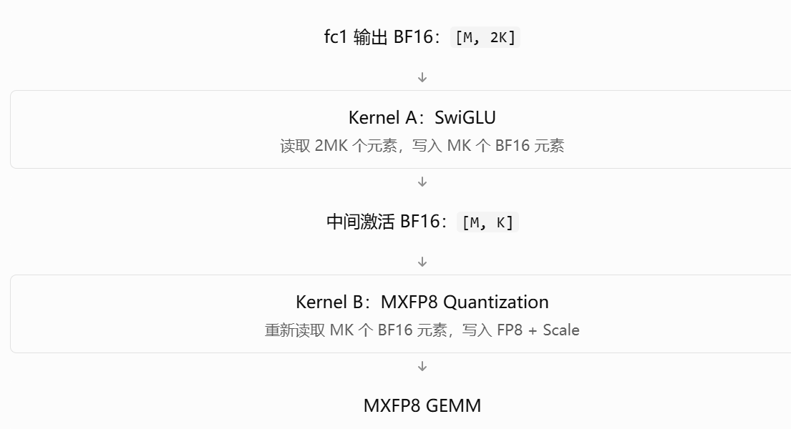
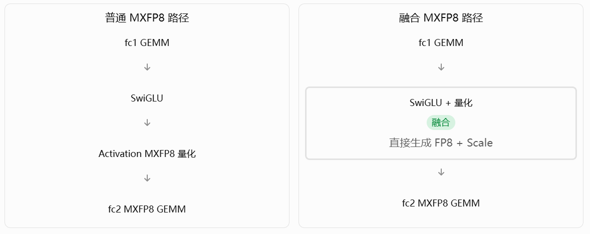
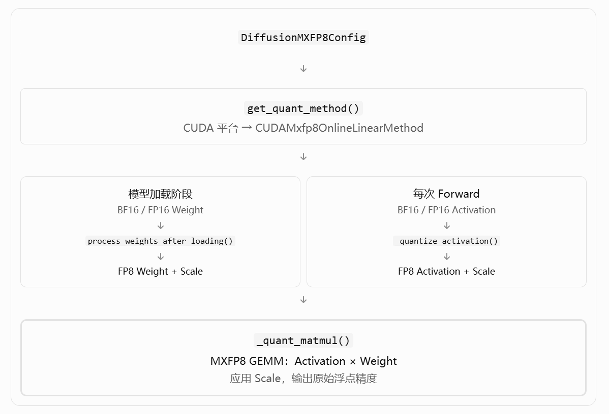

# MiniMax-H3 的 MXFP8 量化与 SwiGLU 融合优化——PR#7988

PR 地址：[vllm-project/vllm-omni #7988](https://github.com/vllm-project/vllm-omni/pull/7988)

## PR目标

在vllm-omni中把 MiniMax-H3 的 **DiT 主干部分** Linear 从 BF16 计算改为在线 MXFP8 计算，并将 SwiGLU 激活与 FP8 量化融合，减少访存和 Kernel 开销。

## 原理介绍

### MXFP8计算

BF16 的每个数占 16 bit。FP8 E4M3 占 8 bit，其中 4 bit 是指数，3 bit 是尾数。

但是普通 FP8 在同一张量中表示不同数量级的数时，容易遇到精度和动态范围问题。

MXFP8（Microscaling FP8）采用一种更细粒度的缩放策略：

沿 K 维，每 32 个元素共享一个 E8M0 Scale。

### 激活融合

原来的 SwiGLU 如何计算？

MiniMax-H3 的 MLP 使用：
$$
 [ G,U ] = XW_1 
$$

$$
 Y=\operatorname{SiLU}(G)\odot U 
$$

$$
 O=YW_2 
$$

其中：
$$
 \operatorname{SiLU}(x)=\frac{x}{1+e^{-x}} 
$$
正常 MXFP8 实现需要：



然后这个PR是将两个kernel进行了融合。融合的是 SwiGLU 激活计算和下一次 GEMM 所需要的量化准备。

## 从源码学习PR思路

### 1.vllm-omni/diffusion(主路径)

#### 1.1 layers(层抽象)

##### mxfp8.py(核心 Triton Kernel)

把原本使用 BF16 的数据压缩成 FP8，让 GPU 用更低的精度执行矩阵乘法，同时把部分计算步骤融合起来，减少中间数据的读写。

`mxfp8.py` 要回答的是：

> 一个 BF16 Tensor 究竟怎样变成 MXFP8？Scale 怎样组织？GPU 如何执行量化后的矩阵乘法？SwiGLU 为什么能够和量化融合？

其中真正的 Triton Kernel 只有两个：

```
_mxfp8_quant_kernel
_silu_mxfp8_cuda_kernel
```

其他函数主要负责 Scale 计算、内存分配、Kernel Launch 和 GEMM 接口封装。

- `mxfp8_quantize_swizzled()`：最核心的量化入口，代码注释中的维度仅仅是举例加深理解

```py
def mxfp8_quantize_swizzled(x):
    rows, k = x.shape#读取输入形状[64,256]
    #q：量化完成后的 FP8 矩阵，形状仍为 [64,256].
    #s：存储每组缩放因子的数组，类型为 uint8
    q, s = _alloc(rows, k, x.device)#分配输出空间.
    n_groups = k // 32#分组,8组  scale 的矩阵形状应该是：[64,8]
    #BLOCK_R = 32：一个 Triton 程序处理 32 行。
	#G = 8：每行处理 8 组，也就是 256 个元素。
    block_r, g = 32, 8#分配 GPU 并行任务
    grid = (
        triton.cdiv(rows, block_r),
        triton.cdiv(n_groups, g)
    )
	#grid=(2,1)  核函数
    _mxfp8_quant_kernel[grid](...)
    return q, s
```

- `_mxfp8_quant_kernel`核函数,这四行基本就是整个 MXFP8 量化算法

```py
def _mxfp8_quant_kernel():
    ......
    x3 = tl.reshape(x, [BLOCK_R, G, 32]) #[32,256]->[32,8,32]  也就是每一行有8组
    amax = tl.max(tl.abs(x3), axis=2)#[32,8,32]->[32,8]  也就是获取每一组的最大值
	#根据最大值计算每组的 scale 编码和逆缩放因子
    sbyte, inv = _mx_e8m0_from_amax(amax)
    #把各组数据乘以对应的逆缩放因子，再转换成 FP8 存储
    q = tl.reshape(x3 * inv[:, :, None], [BLOCK_R, G * 32])
   ......
```

- `_mx_e8m0_from_amax()`：scale 是怎么计算的？

```python
@triton.jit
def _mx_e8m0_from_amax(amax):
    bits = amax.to(tl.int32, bitcast=True)
    e0 = ((bits >> 23) & 0xFF) - 135
    the = (
        ((e0 + 135) << 23) | 0x600000
    ).to(tl.float32, bitcast=True)
    e = e0 + (amax > the).to(tl.int32)
    e = tl.maximum(e, -127)
    inv = (
        (127 - e) << 23
    ).to(tl.float32, bitcast=True)
    return e + 127, inv
```

看起来有点复杂，但它主要做的是：
$$
 e=\left\lceil\log_2\frac{amax}{448}\right\rceil 
$$
对于正常范围内的正数，选择一个整数指数 `e`，满足：
$$
 \frac{amax}{2^e}\leq448 
$$
因为 E4M3FN 的最大有限数值是 448。

- silu_mul_mxfp8_cuda() :SwiGLU 激活和 MXFP8 量化融合

```python
gate = tl.load(base + c[None, :], ...)
up = tl.load(base + hidden + c[None, :], ...)

prod = _cuda_silu_product(gate, up)

p3 = tl.reshape(prod, [BLOCK_R, G, 32])

amax = tl.max(tl.abs(p3), axis=2)

scale_byte, inv = _mx_e8m0_from_amax(amax)

quant = p3 * inv[:, :, None]
```

执行顺序非常清楚：

先读取两个分支的数据，计算 SwiGLU，再直接对结果分组量化。

其中 `_cuda_silu_product()` 使用显式 BF16 舍入及 CUDA 数学操作，是为了让融合后的结果尽量与原来分开执行的 CUDA 路径保持字节级一致，而不仅仅是数学公式上相同。

PR 的测试也专门对比了激活值、FP8 结果和 scale 的字节表示。

#### 1.2 models/minimax_h3(模型相关)

##### quantization.py(确认量化范围)

文件位置：`vllm_omni/diffusion/models/minimax_h3/quantization.py`

通过查看修改文件：

```py
def projection_quant_config(config, prefix):
    """Keep conditioning, AdaLN, VSA gates and token refinement in BF16."""
    if not isinstance(config, DiffusionMXFP8Config) or not current_omni_platform.is_cuda():
        return config
    if prefix.startswith("blocks.") and prefix.endswith((".attn.qkv_proj", ".attn.out_proj", ".mlp.fc1", ".mlp.fc2")):
        return config
    return None
```

当前模型允许的量化层为：“.attn.qkv_proj", ".attn.out_proj", ".mlp.fc1", ".mlp.fc2"

为什么只量化这四类？

主要是为了在加速收益与数值精度之间取得平衡。

Transformer Block 的主要矩阵乘法通常集中在 Attention 和 MLP 的投影层。

这些 GEMM 通常是主要的计算热点，因此值得使用 MXFP8。

而其他层，例如：

- AdaLN：参与归一化和调制参数生成。
- Conditioning：处理条件输入。
- VSA Gates：参与门控计算。
- Token Refinement：参与 Token 细化。
- Patch / Output Projection：处于输入输出边界的投影层。

当前方案不对这些层使用 MXFP8，以避免不必要的精度风险。

**相当于在原先`quant_config`基础上添加了一层过滤效果。**

> 如果不加这个过滤，启用 MXFP8 是否意味着模型中所有层都被量化？原有的 `quant_config` 难道没有过滤功能吗？

答案是：

不是模型所有层都会量化，而是所有接收到 MXFP8 `quant_config`、并且支持该量化方法的层，都可能走 MXFP8 路径。原有的量化框架也有过滤机制，但这次 PR 额外增加了 MiniMax-H3 专属的层级白名单。

##### minimax_h3_transformer.py（模型执行接入）

文件位置：`vllm_omni/diffusion/models/minimax_h3/minimax_h3_transformer.py`

修改核心：让原来的 Transformer Linear 能够选择 MXFP8 计算，并在满足条件时使用 SwiGLU + MXFP8 融合 Kernel。

这里涉及三个不同层次：

1. 量化范围控制：哪些 Linear 使用 MXFP8，哪些保留原始精度。（使用的是quantization.py）
2. 计算实现选择：相同的 Linear 数学运算，底层可以走 BF16 GEMM 或 MXFP8 GEMM。
3. 模型 Forward 优化：绕开独立的 SwiGLU、量化和 Linear 调用，直接执行融合实现。

- QKV projection

  ```py
  self.qkv_proj = QKVParallelLinear(
      ......
      quant_config=projection_quant_config(
          quant_config,
          f"{prefix}.qkv_proj"
      ),
      ......
  )
  ```

  这段修改之后，QKV 的逻辑变成：
  $$
   [Q,K,V]=\operatorname{MXFP8Linear}(X,W_{qkv}) 
  $$
  作者没有自己重新实现 QKVParallelLinear，而是复用了 vLLM 已经存在的并行 Linear 框架。

  原有的 QKV 权重组织、TP 分片、Q/K/V 输出处理仍由 vLLM 的 Linear 逻辑负责。

- Attention Output Projection

```py
self.out_proj = RowParallelLinear(
    ......
    quant_config=projection_quant_config(
        quant_config,
        f"{prefix}.out_proj"
    ),
    ......
)
```

这些初始化阶段只替换原先的`quant_config`配置，所有都一样，其他的不做展示。

- `MiniMaxH3MLP.forward()` 新增融合执行路径

```py
 def forward(self, x: torch.Tensor) -> torch.Tensor:
        hidden, _ = self.fc1(x)
        from vllm_omni.quantization.mxfp8_config import CUDAMxfp8OnlineLinearMethod

        if (isinstance(self.fc2.quant_method, CUDAMxfp8OnlineLinearMethod)
            and self.fc2.tp_size == 1
            and hidden.dtype == torch.bfloat16
            and not self.fc2._forward_hooks
            and not self.fc2._forward_pre_hooks
        ):
            from vllm_omni.diffusion.layers.mxfp8 import silu_mxfp8_linear

            return silu_mxfp8_linear(hidden, self.fc2.weight, self.fc2.weight_scale)
        hidden = self.act_fn(hidden)
        out, _ = self.fc2(hidden)
        return out
```



### 2.vllm-omni/quantization

##### mxfp8_config.py（量化执行框架）

文件位置：`vllm_omni/quantization/mxfp8_config.py`

定义 Linear 权重量化、Activation 量化和矩阵乘法执行方式

整体执行流程：



- 为 CUDA 平台新增 Quantization Method

新增：

```py
if current_omni_platform.is_cuda():
    if self.is_checkpoint_mxfp8_serialized:
        raise NotImplementedError(
            "CUDA MXFP8 currently supports online "
            "BF16/FP16 checkpoints only"
        )
    return CUDAMxfp8OnlineLinearMethod()
```

原有量化框架会根据平台返回不同的量化方法。现在新增 CUDA 分支：`CUDAMxfp8OnlineLinearMethod`

- 新增类

```py
class CUDAMxfp8OnlineLinearMethod(
    _LazyWeightMixin,
    MXFPLinearMethodBase
):
```

以及三个方法：（这种模式叫作模板方法模式：框架固定执行步骤，子类负责平台相关的具体实现。）

```py
    def process_weights_after_loading(self, layer: Module) -> None:
        #权重量化步骤
        ......
        #使用 Blackwell 对应的 Block-Scaled FP8 GEMM 能力
        if capability is None or capability.major not in (10, 12):
            raise ValueError("CUDA MXFP8 requires a Blackwell GPU")
        ......
        #权重量化
        weight, scale = mxfp8_quantize_swizzled(layer.weight.detach().contiguous())
        #把 Linear 原来的浮点权重替换为量化权重
        replace_parameter(layer, "weight", weight)
        #保存权重 Scale
        layer.register_buffer("weight_scale", scale.view(torch.float8_e8m0fnu))

    def _quantize_activation(self, x: torch.Tensor) -> tuple:
        #激活量化
        from vllm_omni.diffusion.layers.mxfp8 import mxfp8_quantize_swizzled
        return mxfp8_quantize_swizzled(x.contiguous())

    def _quant_matmul(self, x_q, x_scale, layer, bias, ori_dtype):
        from vllm_omni.diffusion.layers.mxfp8 import mxfp8_scaled_mm
        return mxfp8_scaled_mm(x_q, layer.weight, x_scale, layer.weight_scale, bias=bias, output_dtype=ori_dtype)
```

**MXFP8 GEMM`mxfp8_scaled_mm`为什么传入四个量化数据？**

因为一次 MXFP8 GEMM 需要：
$$
 X_q,\quad S_X,\quad W_q,\quad S_W 
$$
数学上：
$$
 Y\approx (X_q\odot S_X)(W_q\odot S_W)^T 
$$
这里的 Scale 在 K 维按组广播。

实际硬件执行时，缩放操作由 Block-Scaled GEMM 处理，而不需要单独产生完整的反量化矩阵。

